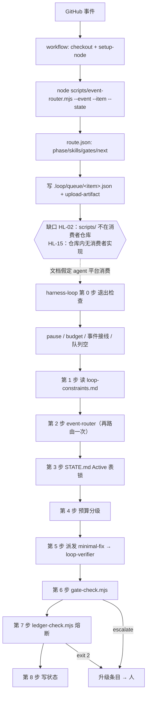

# harness-loop 深度审查报告（完整版）

> **审查对象**：`D:\harness_loop`（技能源仓库），重点 `skills/harness-loop/SKILL.md` 与其下游机制
> **审查方式**：可访问工作区（方式 A）。实际执行测试套件、脚本 CLI、装配流程与对抗性探针
> **审查日期**：2026-10-14
> **证据状态**：`已验证` = 实际运行或实际打开文件得到；`静态判断` = 阅读源码/文本得出；`待验证` = 推演所得
>
> **本文件命名遵循仓库既有约定**（`REVIEW-YYYY-MM-DD-*.md`）。`scripts/test.mjs:1377` 的
> `isHistorical` 判定把这类文件排除在"旧技能名残留"扫描之外——审查记录记录的是"当时发现了什么"，
> 改写它们等于伪造历史。因此本报告**不含**任何后续修正，发现的缺陷在文中保持原样。

---

## 0. 审查范围与边界

### 已执行

| 项目 | 命令 | 结果 |
|---|---|---|
| 测试套件 | `node scripts/test.mjs` | `Passed: 724  Failed: 0` |
| 标准启动路径 | `bash init.sh` | 退出码 0（`harness-stage OK`） |
| 闸门 CLI | `node scripts/gate-check.mjs ...`（20+ 种参数组合） | 见 §3 |
| 熔断器 | `node scripts/ledger-check.mjs ...`（库函数 + CLI） | 见 §4 |
| 路由 | `node scripts/event-router.mjs ...` | 见 §3 |
| 三阶段驱动器 | `node scripts/harness-stage.mjs`（含空仓库跳级） | 见 §3 |
| 装配端到端 | 临时目录 `--upgrade --stage 1/2/3` | 见 §3 |
| 拒绝列表对抗 | 19 个路径探针 | 见 §5.6 |
| 注入对抗 | 本地模拟 GitHub Actions 表达式替换 | 见 §5.6 |

### 未执行（明确列出，不允许省略）

- **GitHub Actions 真实 runner 行为**：无仓库与网络。注入探针为**本地模拟**，结论是"注入可行"，非"runner 上已复现"。
- **真实 agent 宿主中的技能触发与子智能体派发**：无法观测。触发准确性分析为**基于文本的预测**。
- **真实 issue/PR 事件端到端**：需真实事件源。
- **`worktree` 隔离在真实并发下的表现**。
- **`loop-verifier` 在真实环境中能否运行测试**。

### 只读声明

本次审查未修改、删除、覆盖、格式化或重构任何项目文件。所有探针文件已清理，`git status` 干净，`git stash` 为空。§6 的补丁为**草案文本**，未落盘。

---

## 1. 总体评价

### 最值得保留的优点

**它把"停止"做成了机制而不是愿望。** 九类闸门有确定的优先级顺序，每类产出确定的退出码（0/2/3），顺序经过设计——`pause` 优先于 `denylist`（实测：`pause:true` + `.env` → `exit/pause`），拒绝列表优先于尝试上限（安全优先于效率）。配套的 `ledger-check.mjs` 用可复现的归一化算法识别停滞，并在账本不可读时 fail-closed（`no-ledger` / 退出 2）。

更难得的是这个仓库**自己**反复修掉"配置存在却无人读取"的装饰性机制，把这条写成硬约束 11，并用**行为断言**守住（`test.mjs:1671-1685` 证明改 `registry.yaml` 的阈值会改变行为）。724 项断言全绿是真实的，`bash init.sh` 退出 0。

### 最大的结构性风险

**闸门信任它的调用方。** 三处同源证据：`--verdict approve` 不需要任何证据文件；`--reviewed-sha` 不做格式或存在性校验；拼错的标志被静默丢弃。三者合起来意味着**硬约束 1（独立验证者）、7（绑定审过的 commit）、8（回退测试）目前都由被约束的一方自证**。

这不是"提示词代替机制"——机制存在且有牙齿——而是机制**把一个不可信的输入当成了可信证据**。它比 §3 列出的三个 P0 更根本：P0 是可以逐个修的具体 bug，而这一个是设计前提。

### 核心循环是否完整

分层回答：

- **机制层：是。** 继续/停止由脚本退出码产生，不由模型自述。闸门读取可验证的外部事实（git SHA、从文档解析的拒绝列表、测试退出码、registry 阈值）。失败诊断有可复现算法与熔断阈值。
- **验证层：一半。** 三态（PASS/FAIL/NOT RUN）、回退测试、"无法跑测试即升级"都有真闸门字段与测试守护——**这是全项目最扎实的部分**。但"派发一个独立验证者"仍是提示词，且 approve 无需证据。
- **交付层：否。** 三个 P0 使闭环在新装配的项目里无法按文档跑通；预算与暂停两个关键输入无代码入口；`harness-loop` 第 2 步不传 `--target` 使多循环互斥完全不生效。

准确表述：**脚本层闭环闭合且可验证；编排层与交付层未闭合。** 它现在是一个"设计正确的闭环 + 装配不上、命令对不齐、且信任调用方自证"的执行体。

### 是否适合在真实项目中使用

**受控试验**，且是修完 §7 第一阶段第 1–4 项之后。

- 可以用：单次审计、装配新项目、人在场的规则增强——这些路径实测可用。
- 谨慎用：事件驱动。在 `HL-02`/`HL-04`/`HL-05` 修好之前，workflow 在真实 runner 上会失败或可被注入，而阶段 3 判据会给一个跑不起来的事件脊发 PASS。
- 不要用于：任何无人值守的自动合并或生产环境改动。

### 信心与限制

信心较高：§3 的 P0/P1 全部为本地实跑复现，命令与退出码均已捕获。主要限制是**未在真实 runner 上跑过 workflow**、**未观测真实 agent 宿主的触发行为**。§5.6 的注入结论是本地模拟而非实机。

---

## 2. 项目理解与实际执行流程

### 架构与文件职责

| 层 | 载体 | 职责 |
|---|---|---|
| 地基（harness 五子系统） | `AGENTS.md` / `STATE.md` / `loop-constraints.md` / `feature_list.json` / `progress.md` / `LESSONS.md` / `init.sh` | 指令、状态、验证、范围、生命周期 |
| 运行层（loop 六原语） | `scripts/*.mjs` + 5 个 loop 机制文档 | 路由、预算、熔断、闸门、账本、接力 |
| 脊柱（事件脊） | `examples/github-actions/*.yml` + `scripts/event-router.mjs` | 事件 → 阶段 → 技能 → 闸门 |
| 技能包 | `skills/*/SKILL.md`（17 个）+ `scripts/install-skills.mjs` | 可安装到 `.agents/skills/` 的行为指令 |
| 建设驱动 | `scripts/harness-stage.mjs`、`scripts/loop-audit.mjs` | 装配与判定 |

`harness-loop` 的定位是**顶层编排**：它不执行具体动作，只决定派发谁、何时停、何时交给人。

### 真实执行流程



**依赖的外部能力**：Node ≥ 20（脚本零依赖）、GitHub Actions、`gh` CLI、agent 宿主的**子智能体能力**（第 5 步的执行者/验证者分离完全依赖它，仓库内无任何代码支撑）。

### 与声明目标的一致性

按 `harness-loop` 自身声明评估（"把一条事件跑完：路由 → 约束 → 预算 → 派发 → 闸门 → 状态"）：**实现与声明一致**——8 步与脚本入口一一对应，没有虚构的步骤。真正的偏差不在步骤，而在"声明写了、命令对不上、或装配后跑不起来"。

---

## 3. 问题清单

### P0（重大安全隐患，或核心流程无法工作）

---

#### HL-01　编排技能自己的命令会让拒绝列表闸门静默失效

**位置**：`skills/harness-loop/SKILL.md:115-123`；实现 `scripts/gate-check.mjs:326-338`；同样错误见 `docs/03-gates-and-levels.md:141`

**证据原文**（技能第 6 步）：

```bash
node scripts/gate-check.mjs \
  --item <item-id> \
  --phase <phase> \
  --attempts <n> \
  --diff-files <changed-files.txt> \
  --verdict <approve|reject|none> \
  --budget-pct <n>
```

**实测**（同一份含 `.env` 的清单，三种传法）：

| 传法 | `files_changed` | `decision` | `gate` |
|---|---|---|---|
| `--diff-files @list.txt`（正确） | 1 | **escalate** | `denylist` |
| `--diff-files list.txt`（技能文档字面写法） | 1 | **proceed** | `null` |

**问题与影响**：`gate-check.mjs:329` 只认显式 `@path` 才把参数当文件清单读；裸参数被当作"单个逗号分隔路径"。于是按技能文档原样执行时，`changed-files.txt` 这个**文件名本身**成了唯一"改动文件"，真实清单从未参与拒绝列表比对。

触发条件是"照文档执行"——最常发生的路径。影响是安全关键方向的 fail-open：`auth/**`、`.env`、`payments/**` 的改动会以 `proceed` 通过闸门，而 `proceed` 的 `allowed_actions` 明确包含 `propose PR`。

同一错误还出现在 `docs/03:141`，且该文档给出的示例输出是 `escalate/denylist`——**那份输出不可能是那条命令产生的**，说明这个示例从未被执行过。

**修改建议**：技能命令块改为 `--diff-files @changed-files.txt`，并加一句"`@` 不可省"。更稳的做法是在 `gate-check.mjs` 里对裸参数 fail-closed（但注意现有实现刻意保留"不按文件系统状态改变语义"的设计，见 `test.mjs:967-968`）。

**验收方法**：从 `SKILL.md` 提取 `--diff-files` 后的值跑一次含 `.env` 的清单，必须 `escalate`。改回裸写法时测试必须变红。

**证据状态**：**已验证**。

---

#### HL-02　`scripts/` 从不部署到被装配项目，但所有技能命令与全部 workflow 都依赖它

**位置**：`scripts/harness-stage.mjs:616,637`（仅 `copyTemplate`）；`scripts/install-skills.mjs:94-113`（仅复制 `SKILL.md`）；`examples/github-actions/*.yml`（7 处 `node scripts/...`）

**实测**：装配一个干净项目到阶段 2 后，目录内容为

```
.agents  AGENTS.md  LESSONS.md  LOOP.md  STATE.md  feature_list.json  init.sh
loop-budget.md  loop-constraints.md  loop-ledger.json  loop-run-log.md
package.json  progress.md  session-handoff.md
```

**没有 `scripts/` 目录**。随后在该项目里执行 `harness-loop` 第 0 步的接线检查命令（`SKILL.md:40-44` 原文）：

```
Error [ERR_MODULE_NOT_FOUND]: Cannot find module '...\consumer\scripts\lib\common.mjs'
```

**问题与影响**：`harness-stage.mjs` 只写模板文件，`install-skills.mjs` 只写 `SKILL.md`，全仓库没有任何一步把 `scripts/` 交付给消费者项目；文档里也没有一句"把 scripts/ 复制过去"。而技能里的每一条命令都写 `node scripts/xxx.mjs`（隐含 cwd = 项目根），workflow 更是先 `actions/checkout` 消费者仓库再 `node scripts/event-router.mjs`——**在真实 runner 上必然失败**。

更糟的是阶段 3 判据 1（事件接线）只看 workflow 文件是否存在，把示例 workflow 拷过去就能判 PASS，而它们一跑就崩——**判据给一个跑不起来的事件脊发绿灯**。

（若设计意图是"agent 以 cwd = 技能包仓库运行、用 `--target` 指向消费者"，那么缺陷变成"这个模型没有任何一处写明"，且 workflow 的写法与它矛盾。两种读法都需要修。）

**修改建议**：二选一并显式化——(a) `harness-stage.mjs --upgrade` 增加一步把 `scripts/`（含 `lib/`）复制进目标仓库，并在阶段判据里检查它；(b) 明确"运行脚本时 cwd 必须是技能包仓库"，把所有技能命令与 workflow 改为调用包内绝对路径。**推荐 (a)**，因为 workflow 必须在消费者仓库内运行。

**验收方法**：装配阶段 2 到临时目录后，在该目录内跑 `node scripts/gate-check.mjs --help` 与第 0 步 helper，退出码必须为 0。

**证据状态**：**已验证**。

---

#### HL-03　`close` 阶段被路由到，但闸门脚本的枚举里没有它

**位置**：`scripts/event-router.mjs:42-49,94-100,133-139` 路由 `issues.closed`、`pull_request.closed:unmerged`、`release.published` 到 `phase: 'close'`；`scripts/gate-check.mjs:42` 的 `PHASES` 无 `close`

**实测**：

```
$ node scripts/gate-check.mjs --item x --phase close --attempts 1 --verdict none
error: --phase must be one of: intake, review, fix, verify, gate, post-merge, release (got: close)
EXIT=1
```

**问题与影响**：三个已注册事件的路由结果是编排技能**无法继续执行**的输入。退出码 1 在 `gate-check.mjs:311-313` 的定义里是"参数错误"，不属于 `proceed/report-only/escalate/exit` 四态中的任何一态——技能第 6 步只规定了 `escalate → 写升级条目`、`exit → 立即停止`，对"参数错误"没有规定动作。

触发条件：任何 issue 关闭、PR 未合并关闭、release 发布。影响：要么 agent 卡在未定义状态，要么被当作"闸门没问题"继续——而 `post-merge-cleanup` 是这三个事件的目标技能，属于会改文件的 L1 阶段。

注意 `LOOP.md:39,44` 自己把 `release.published` 写在 `release` 阶段（见 HL-13），三方不一致。

**修改建议**：在 `PHASES` 增加 `'close'`（并确认该阶段套用哪些闸门——建议至少 `denylist` + `scope`），或把三个事件改路由到已有阶段。二者必须与 `LOOP.md` 路由表和 `test.mjs` 第 17 节一起改。

**验收方法**：遍历 `ROUTES` 的每个 `phase`，都必须属于 `PHASES`；变异（删掉 `'close'`）后测试必须变红。

**证据状态**：**已验证**。

---

#### HL-04　workflow 把不可信事件字段直接插值进 shell

**位置**：`examples/github-actions/ci-sweeper.yml:49-56`、`pr-review.yml:35-40,78-84`、`issue-intake.yml:34-58`

**实测**（模拟 GitHub Actions 的"先替换表达式、再交 bash 执行"顺序）：

```
输入 branch: x"; echo INJECTED-COMMAND-RAN; "
→ 输出: INJECTED-COMMAND-RAN
```

**问题与影响**：GitHub 官方文档明确把"在 `run:` 中使用 `${{ github.event.* }}`"列为脚本注入风险。受影响字段：

| 文件:行 | 字段 | 用户可控 |
|---|---|---|
| `ci-sweeper.yml:51-52` | `workflow_run.head_branch` / `check_suite.head_branch` | **是**（分支名） |
| `pr-review.yml:82` | `pull_request.head.ref` | **是** |
| `issue-intake.yml:53` | `issue.title` | **是**（虽在 heredoc 内，仍进 shell 解析） |
| `pr-review.yml:39` | `review.state` | 枚举，风险低 |

**实际影响范围（已核实）**：这些 workflow 均未引用自定义 secret（`grep secrets\.` → 只有 `daily-triage`/`merge-gate`/`release-draft` 用 `GITHUB_TOKEN`，而这三个恰好**没有**不可信插值）。所以最坏后果不是凭据外泄，而是：(1) 在 runner 上执行任意命令；(2) 写入 `$GITHUB_OUTPUT` 篡改后续步骤的 `item`/`branch`，操纵 work item 内容；(3) 构造越权路径——实测 `branch=../../etc/passwd` → 目标路径 `.loop/queue/ci-abc1234-../../etc/passwd.json`。

**修改建议**：见 §6 补丁 P0-B（改用 `env:` 间接层 + 字符消毒）。

**验收方法**：静态断言——任何 `.yml` 的 `run:` 块内不得出现 `${{ github.event.`（允许出现在 `env:` 段）；行为测试用构造串跑一次，输出不得含注入标记。

**证据状态**：**本地模拟已验证；runner 实机待验证**。

---

#### HL-05　未知/拼错的命令行标志被静默忽略 → 闸门被静默关闭

**位置**：`scripts/lib/common.mjs:96-124`（`parseArgs` 无未知标志校验）；`scripts/gate-check.mjs:355-373`（只校验已知标志的**值**）

**实测**：

| 命令 | 输出 |
|---|---|
| `--diff-files @list.txt`（正确） | `files_changed: 1` → **escalate**（denylist 命中） |
| `--diff-filesx @list.txt` | `files_changed: 0` → **proceed** |
| `--attemptsx 99`（应为 `--attempts`） | `attempts: 0` → **proceed** |

**问题与影响**：`parseArgs` 把任何 `--foo` 都收进 `args`，没有消费者的标志被无声丢弃。于是"标志名拼错"等价于"该闸门没启用"，而工具照常输出 JSON、照常退出 0。

这与该仓库已修掉的一类 bug 同源——`gate-check.mjs:346-347` 的注释写着"`Number('abc')` 是 NaN，而 `NaN >= n` 恒为 false——一个拼错的阈值会把所有熔断器关掉，同时工具报告成功。必须在进 `checkGates` 之前拦住。" **值层面的 NaN 拦住了，标志名层面同样的失效完整存活。**

触发条件：任何手写命令行（agent 生成命令时尤其容易多字少字）。影响：`--attempts`、`--diff-files`、`--red-check`、`--reviewed-sha` 任一拼错，对应硬约束静默失效。

**修改建议**：在三个脚本的 `main()` 里加未知标志白名单校验。

**验收方法**：断言 `--diff-filesx`、`--attemptsx` 均退出 1；变异（移除白名单）后必须变红。

**证据状态**：**已验证**。

---

### P1（核心闭环、验证、恢复或终止机制存在严重缺陷）

---

#### HL-06　闸门接受自证：`--verdict approve` 不需要任何证据

**位置**：`scripts/gate-check.mjs:231-281`（第 9 类闸门）；`scripts/gate-check.mjs` 全文只有 3 处文件读取

**实测**：

```
# 无任何 verifier 存在，sha 是假串
$ node scripts/gate-check.mjs --item pr-77 --phase gate --diff-files @list.txt \
    --verdict approve --red-check pass --reviewed-sha deadbeef --head-sha deadbeef --budget-pct 5
{ "decision": "proceed", "gate": null, "reason": "all gates passed", "checks_not_run": [] }

# sha 甚至不是十六进制
$ ... --reviewed-sha NOT-A-SHA --head-sha NOT-A-SHA ...
{ "decision": "proceed", "reason": "all gates passed" }
```

`grep -nE "readFileSync|readText|readJson" scripts/gate-check.mjs` → 仅 3 处，其中 2 处在 `main()` 里读自己的源码和 diff 清单文件，**没有一处读取 verifier 报告、测试输出或任何证据文件**。

**问题与影响**：`--verdict approve` 是一个断言，不是一个证据。`--reviewed-sha` 只做字符串相等比较（`gate-check.mjs:191`），不做格式或存在性校验。因此"约束 7：合并必须绑定审查过的 commit"实际只保证"调用方声称的两个字符串相同"。

**为什么这是问题**：硬约束 1（执行者与验证者必须是不同智能体）与约束 7 都是**不可由调用方自证**的性质，而当前设计让调用方成为这两条的唯一证人。`loop-verifier:159` 写"默认立场 REJECT，直到被证明否则"——但 `gate-check` 接受 `--verdict approve` 时**不要求任何证据**，所以"被证明"这个环节没有承载物。

对照 `loop-constraints.md` 的约束 11 精神：这里的情况是"一个接受自证的闸门，和一个不存在的闸门，在退出码上同样不可区分"。

**修改建议**：见 §6 补丁 P0-A。`--phase gate` 且 verdict 为 `approve` 时必须提供 `--evidence-file`，且该文件须包含 verifier 的 verdict 行与至少一条真实命令输出行。

**验收方法**：无证据 → `escalate`（`gate: verification-evidence`）；证据自称 REJECT 而命令行说 approve → `escalate`；合规报告 → `proceed`。变异后必须变红。

**证据状态**：**已验证**。

---

#### HL-07　随包发布的 merge-gate 永远 `escalate`，一次也不可能 `proceed`

**位置**：`examples/github-actions/merge-gate.yml:66-73`；`scripts/gate-check.mjs:179-204,219-229`

**实测**（原样命令）：

```json
{ "decision": "escalate", "gate": "head-commit",
  "reason": "gate phase requires both --reviewed-sha and --head-sha (reviewed: missing, head: missing)" }
```

补上两个 sha 后仍 `escalate`，这次是 `gate: "red-check"`；再加 `--red-check pass` 才 `proceed`。

**问题与影响**：`--phase gate` 同时要求 `--reviewed-sha` + `--head-sha`（约束 7）和 `--red-check` 非 `not-run`（约束 8），而发布的 workflow 三个都没传。**这个闸门在"批准 PR"这条唯一路径上永远返回 escalate。**

判定方向是安全的（fail-closed），但后果是运维性的：每个 ready_for_review 的 PR 都收到"human decision required"，`Fail if escalated` 让 job 变红。持续假升级会训练人忽略它，最终闸门被关掉。

同时 `harness-loop/SKILL.md:115-123` 的命令也缺这四个参数（`--reviewed-sha`/`--head-sha`/`--red-check`/`--not-run`/`--constraints-root`），即编排层根本不知道如何满足自己声明的约束 7/8/9。`STATE.md:11-16` 已把这四条记为待办——**已知但未修，且没有被任何测试守住**。

**修改建议**：`merge-gate.yml` 增加 step 取 `headRefOid` 与最近一次 review 的 `commit_id`；`--red-check` 从 PR body 的固定标记读取，读不到就显式传 `not-run` 并让人看到"未跑"；`SKILL.md` 第 6 步命令补齐五个参数。

**验收方法**：把 merge-gate 的完整命令作为断言输入，必须能到达 `proceed`；删除任一参数后必须 `escalate` 到对应 gate。

**证据状态**：**已验证**。

---

#### HL-08　verifier 的 verdict 词汇表与 gate-check 的枚举不兼容

**位置**：`skills/loop-verifier/SKILL.md:128`（`APPROVE | REJECT | ESCALATE_HUMAN`）；`scripts/gate-check.mjs:43`（`['approve','reject','escalate-human','none']`）

**实测**：

```
$ node scripts/gate-check.mjs --item x --phase fix --verdict ESCALATE_HUMAN
error: --verdict must be one of: approve, reject, escalate-human, none (got: ESCALATE_HUMAN)
EXIT=1
```

**问题与影响**：`loop-verifier` 明确定义自己的 verdict 字面量是大写下划线，而编排技能第 6 步要求把它作为 `--verdict` 传给 gate-check。两处都按文档执行必然得到退出码 1（"参数错误"，非四态之一）。

触发条件：verify 阶段的正常交接。影响：`ESCALATE_HUMAN` 这一最重要的人工升级信号，会在传递途中变成一个未定义状态——而它恰恰是"verifier 无法运行测试，不许放行"的那条路径。`harness-loop/SKILL.md:204` 的输出模板同样使用大写下划线。

**修改建议**：在 `harness-loop` 第 6 步与 `loop-verifier` 输出格式中显式给出映射，或让 `gate-check` 接受归一化后的值。

**验收方法**：断言两种写法产出同一 decision。

**证据状态**：**已验证**。

---

#### HL-09　预算与暂停开关是纯提示词，无代码入口；且文档示例会让暂停永久生效

**位置**：`skills/harness-loop/SKILL.md:30-33,89-94`；`scripts/gate-check.mjs:90-98,362`；`docs/03-gates-and-levels.md:141`；`examples/github-actions/merge-gate.yml:38-60`

**证据与实测**：

1. `gate-check.mjs:362` 的 `pause: Boolean(args.pause)` —— 暂停状态**由调用方传入**，脚本从不读 `loop-constraints.md` / `STATE.md` / issue 标签。全仓库只有 `daily-triage.yml` 和 `lesson-harvest.yml` 两个 workflow grep `loop-pause-all`，**没有任何 workflow 把 `--pause` 传给 gate-check**。
2. `docs/03:141` 的示例写 `--pause false`。实测 → `decision: "exit"`、`gate: "pause"`、`reason: "loop-pause-all is active"`。原因：`common.mjs:84-87` 的 `BOOLEAN_FLAGS` 含 `pause`，`--pause false` 解析成 `pause=true` + 位置参数 `false`。**照文档执行会得到永久紧急刹车。**
3. 预算百分比没有脚本，只在 `merge-gate.yml:38-60` 内联计算；该逻辑用 `Math.max(...caps)` 取全表最大上限。实测 `loop-budget.md` 抽出的 caps 为 `[80000, 300000, 500000, 100000, 200000, 100000]`，取到 **500000**（CI Sweeper 的上限）。于是 PR Review Triage 花掉 250k（占自身 300k 上限的 83%，本应 report-only）会被算成 50%，判定"正常"。`STATE.md:44` 已把这条记为已知项。

**问题与影响**：约束 11 说"任何被文档描述为'机械判定'的机制，必须有一个真正读它的代码入口"。预算是这套框架唯一的经济性来源（`loop-budget.md` 自己说"15 分钟一次空转一天 96 次 × 5k = 480k 纯浪费"），而它现在是**声明 + 一个算错的内联片段**。

**修改建议**：见 §6 补丁 P1-G（新增 `scripts/budget-check.mjs`）。

**验收方法**：per-loop 上限改动必须改变行为；`loop-pause-all` 独占行存在时返回 exit 3；`--pause false` 不再触发 exit。

**证据状态**：**已验证**。

---

#### HL-10　执行者/验证者隔离与 worktree 完全依赖提示词，无结构性保证

**位置**：`skills/harness-loop/SKILL.md:104-111`；`skills/loop-verifier/SKILL.md:16-24`

**证据**：`grep -rn "worktree" scripts/*.mjs` 只命中注释与审计评分（`loop-audit.mjs:229` 用 `/worktree/i.test(corpus)` 给分），**没有任何代码创建 worktree**；`grep -rn "sub-agent|Agent(" scripts/*.mjs` 只命中 `next` 文案。`loop-verifier:24` 规定"若发现自己与执行者共享上下文 → 立即 ESCALATE_HUMAN"——这是让验证者自查它无法自查的东西。

**问题与影响**：这是整个设计的地基（`loop-verifier:166-172` 论证得很清楚），但落地形式是"技能里写了必须"。硬约束 1 说"执行者与验证者必须是不同的智能体、不同的指令"——**这条约束目前不可机械判定**，也没有测试。`STATE.md:45` 已把它记为建议项。

严格说这不是 `harness-loop` 的缺陷（子智能体派发是宿主能力，脚本层无法强制），但它是"提示词承诺 vs 机制支撑"分界线上最重的一条。可部分补救的是 worktree——那是本地命令，可以脚本化。

**修改建议**：(a) 新增 `scripts/worktree.mjs`（`create`/`discard`）；(b) 把"独立实例"表述为宿主要求，并写明不支持子智能体的宿主应降级为"人充当 verifier"，而不是假装分离。

**验收方法**：断言 `worktree.mjs create` 真的产出 `loop/<event>-<item>-attempt<N>` 分支且 `discard` 清理干净；对 (b) 只能人工确认，应显式标为人工判据。

**证据状态**：**已验证**（代码读取 + grep 覆盖性检查）。

---

### P2（影响可靠性、触发准确性、兼容性、可维护性或效率）

---

#### HL-11　事件接线判据的假阳性：任何名字里带 "triage/loop" 的 workflow 都算接线

**位置**：`scripts/lib/common.mjs:397-418`（判定正则 `:402`）

**实测**：构造只含第三方官方 action 的仓库

```yaml
# .github/workflows/release-drafter.yml
- uses: release-drafter/release-drafter@v6
```

→ `hasEventWiring` 返回 `{ wired: true, via: 'workflow', detail: '.github/workflows/ 下的 1 个文件' }`。正则 `/loop|triage|ci-sweeper|merge-gate|post-merge|release-draft|lesson-harvest|issue-intake/i` 匹配**文件名**，`release-drafter` 命中的是 `release-draft`，任何 `triage.yml` 也会命中。

**问题与影响**：这个 helper 有两个消费者——`harness-loop` 第 0 步和阶段 3 判据 1（`test.mjs:1473` 明确断言两者读同一答案）。假阳性的后果方向危险：`harness-loop` 会以为项目已接事件、继续跑完 8 步对着空队列空转（把"没做事"记成一次正常运行），阶段 3 判据给一个不存在事件脊的项目发 PASS。

注意空目录、只有 `ci.yml` 的目录都正确返回 false（`test.mjs:1479-1484` 覆盖），说明作者已想到边界，只是匹配面太宽。

**修改建议**：改为读 workflow 内容而非文件名——要求同时出现 `event-router.mjs` / `gate-check.mjs` / `ledger-check.mjs` 调用，以及 `on:` 触发器。

**验收方法**：断言"只有官方 release-drafter action 的仓库未接线"；变异后必须变红。

**证据状态**：**已验证**。

---

#### HL-12　`LOOP.md` 的阶段判据数仍写 10，而漂移检测的扫描清单漏了它

**位置**：`LOOP.md:11`；`scripts/test.mjs:672-675`（`docFiles` 只含 `README.md`、`AGENTS.md`、`docs/*`）

**问题与影响**：`README.md:74`、`AGENTS.md:94`、`docs/11:45`、`docs/12` 都已改为 8 项，`LOOP.md` 是唯一遗留。测试的正则 `/1[01]\s*项/` **能**命中 `10 项（全机械）`——它之所以没红，唯一原因是 `LOOP.md` 不在 `docFiles` 里。

这是"新增了守卫但守卫的覆盖范围有洞"的典型：`loop-run-log.md:65` 记载上一轮专门为此加了漂移检测（"推送后自查发现 README 三阶段表……共 5 处还写着 10 项判据与 18 个技能……而没有任何东西在校验它们"），而这次漏掉了最像"调度唯一真相源"的那个文件。

**修改建议**：`docFiles` 加入 `LOOP.md`（以及 `templates/LOOP.md`）；修 `LOOP.md:11` 为 8 项。

**验收方法**：断言 `LOOP.md` 不含 `1[01]\s*项`；把 `LOOP.md` 从 `docFiles` 移除后测试必须变红（守住覆盖范围本身）。

**证据状态**：**已验证**。

---

#### HL-13　`LOOP.md` 与 `ROUTES` 的两个事件阶段不一致，测试只比对事件名不比对阶段

**位置**：`LOOP.md:39,44`；`scripts/event-router.mjs:110-116,133-139`；`scripts/test.mjs:1624-1640`

**实测**（逐行比对）：

| 事件 | LOOP.md 阶段 | ROUTES 阶段 |
|---|---|---|
| `check_suite.completed:success` | `report` | `verify` ← 漂移 |
| `release.published` | `release` | `close` ← 漂移 |

**问题与影响**：`LOOP.md` 自称"调度与路由的唯一真相源"，`event-router.mjs:17-19` 也写"与 LOOP.md 保持一致……修改路由时两处都要改"。测试第 17 节做了双向**事件名**核对（含"LOOP.md 声明了无法路由的事件"这个方向，写得很对），但**从不比对 phase**。`report` 和 `verify` 都合法存在于 `PHASES`，所以不会像 HL-03 那样立刻崩，只会让人按文档预期读错阶段。

**修改建议**：把测试 17 扩展到逐事件比对 `phase`。注意 `report` 不是合法 phase，LOOP.md 那一格也应改成 `verify`。

**验收方法**：断言每个事件的 `LOOP.md phase === ROUTES[event].phase`。

**证据状态**：**已验证**。

---

#### HL-14　`outcome` 枚举三处不一致，且仓库自己的运行记录一条都不符合

**位置**：`loop-run-log.md:24`（声明 5 值）；`skills/harness-loop/SKILL.md:161-169`（新增 `no-wiring`）；实际 6 条记录全部是 `"outcome":"fixed"`

**问题与影响**：`loop-run-log.md` 的 Metrics to Watch 表要按 `outcome` 统计空转率、升级率、平均尝试次数——而实际写入的值不在任何声明的枚举里，也没有任何校验。`harness-loop:170` 特别强调"别把 `no-wiring` 记成 `escalated`，否则阶段推进的信号会丢在噪声里"，但同一份文件里的 `fixed` 已经让所有统计口径失效。

影响：`loop-budget` 的预算估算与 `loop-audit` 的活动检测都依赖 run-log，口径混乱会让"这套循环到底有没有在工作"无法回答。讽刺的是，这正是项目自己诊断过的"没有可执行入口的声明"。

**修改建议**：把 `no-wiring` 加进枚举说明；历史 6 条 `fixed` 归一（或正式加 `manual` 并说明不计入循环统计）；加断言校验每条 `outcome` ∈ 枚举。

**验收方法**：断言 run-log 每条 JSON 的 `outcome` 在枚举内；注入非法值后必须变红。

**证据状态**：**已验证**。

---

#### HL-15　`.loop/queue/` 的消费者不存在，交付物不是 agent 会读的位置

**位置**：`examples/github-actions/README.md:57-78`；`docs/10-how-to-use.md:162`

**证据**：workflow 写 `.loop/queue/<item>.json` 并 `upload-artifact`（上一轮已修）；但全仓库**没有任何消费者实现**，也没有轮询该目录的代码。README 自己承认"artifact 有保留期，也不是 agent 默认会读的位置"，并建议改用评论或 dispatch。

**问题与影响**：`harness-loop` 第 0 步第 4 条要求判断"本事件对应的队列为空"——**它读哪个队列？** 没有任何脚本定义队列位置或读取方式。事件脊的最后一跳（"事件 → agent 开始工作"）在代码上是空的，只有文档描述。另外 queue 文件用 `cat >` 覆盖写入，同一 item 重复触发会丢历史。

**修改建议**：给出最小消费者（如 `scripts/queue-read.mjs`），或在 `harness-loop` 第 0 步明确"队列"的具体载体（如 `STATE.md` 的 High Priority 区）。

**验收方法**：断言第 0 步引用的队列路径有对应读取脚本；空队列与非空队列分别得到 `no-op` 与继续。

**证据状态**：消费者缺失为**已验证**；"第 4 条无法执行"为**静态判断**。

---

#### HL-16　`loop-guard` 指示使用一个不存在的标志 `--inject`

**位置**：`skills/loop-guard/SKILL.md:55`

**实测**：`grep -rn "inject" scripts/*.mjs` 无输出；`node scripts/ledger-check.mjs --ledger loop-ledger.json --inject "trim"` → 正常输出 `verdict: ok`、退出 0（未知标志被静默忽略，与 HL-05 同源）。

**问题与影响**：agent 会以为它执行了提示词裁剪，实际什么也没发生——而且因为 `parseArgs` 不报错，**没有任何信号表明这一步是空的**。这条恰好落在"重试前裁剪上下文"这个降低 token 消耗的动作上，失效时表现为"预算照烧但以为已优化"。

**修改建议**：要么实现 `--inject`，要么把该行改为真实存在的动作。

**验收方法**：断言文档里出现的每个 `--flag` 都在对应脚本的已知标志集合内（可写成通用测试，一次覆盖 HL-01/HL-07/HL-16 三类）。

**证据状态**：**已验证**。

---

#### HL-17　实际可发现的技能副本比被审查的源码旧一版

**位置**：`C:\Users\tom\.zcode\skills\harness-loop\SKILL.md`（198 行）vs `skills/harness-loop/SKILL.md`（225 行）；`~/.zcode/skills/.loop-harness-install.json`

**实测**：`diff` 显示已安装副本**缺少** `stage: runtime` frontmatter、整段 `stage: runtime` 说明注释、以及第 0 步的第 3 条（事件接线检查 + `hasEventWiring` 调用 + `no-wiring` 对照表）。manifest 仍列出已删除的 `harness-bootstrap`、`harness-strengthen`，且这两个目录仍存在于安装目录。

**问题与影响**：宿主真正加载并执行的是旧副本——**第 0 步边界自检在用户机器上根本没生效**。这印证了 `docs/10:55` 自己写的"`skills/` 目录仍是唯一真相源。改完技能要重跑安装脚本推送更新，否则装的还是旧版"——但没有任何机制在源码改动后提醒或自动同步，724 项断言全在源码仓库内，测不到安装副本。触发条件：任何一次技能改动后未重装。影响：文档/测试描述的能力与 agent 实际行为不一致，且不一致是静默的。

**修改建议**：`install-skills.mjs` 增加 `--check` 模式（比较已安装副本与源码，列出漂移并非零退出）；把"安装副本与源码一致"纳入发布前检查；`--uninstall` 清理 manifest 里已不存在的技能目录。

**验收方法**：临时目录安装后修改源码，`--check` 必须报告漂移并非零退出。

**证据状态**：**已验证**。

---

#### HL-18　错误归一化过于激进：不同错误码被判为同一签名

**位置**：`scripts/ledger-check.mjs:43-63`（`:59` 的 `s.replace(/\b\d+\b/g, '<n>')`）

**实测**：

```
SAME SIGNATURE  | exit code 1 vs 2      → 都归一为 "error: process exited with code <n>"
SAME SIGNATURE  | HTTP 500 vs 404       → 都归一为 "fetch failed: status <n>"
SAME SIGNATURE  | 断言期望值 5/6 vs 7/8  → 都归一为 "assertionerror: expected <n> to equal <n>"
distinct        | 路径不同               → 保留 basename（正确）
```

行为验证：3 次**不同**退出码 → `verdict: stagnation` / exit 2。

**问题与影响**：`\b\d+\b → <n>` 抹掉了**所有**裸数字，包括错误码与断言值。后果：agent 依次遇到"500 服务端错误"→"404 路由缺失"→"超时"三种**根因完全不同**的失败，会被判为 `stagnation` 并在第 3 次熔断。

失效方向是安全的（提前停止、交给人），但会**过早熔断本可自愈的循环**——而这套框架的经济性恰恰依赖"该停才停"。

**修改建议**：保留时间戳/hex/路径/行列号的归一化，但不要抹掉错误码与断言值——只归一化"看起来像行号/偏移量"的数字。

**验收方法**：断言 `exit code 1/2/3` 与 `HTTP 500/404` 序列不触发 `stagnation`；断言行号差异仍触发。

**证据状态**：**已验证**。

---

#### HL-19　拒绝列表大小写敏感，可被改名绕过

**位置**：`scripts/lib/common.mjs:493,495`（`globToRegex` 生成的 `RegExp` 无 `i` 标志）

**实测**（19 个探针中的两处失败）：

| 输入 | 结果 |
|---|---|
| `.env` / `config/.env` / `.env.production` | **BLOCK** ✓ |
| `./auth/x.ts` / `/repo/auth/x.ts` / `C:\repo\auth\x.ts` / `auth\login.ts` / `auth//login.ts` | **BLOCK** ✓ |
| `src/auth/login.ts` / `src/payments/api.ts` / `db/migrations/001.sql` | **BLOCK** ✓ |
| `config/secrets.yml` / `src/credentials.json` / `secrets.yaml` | **BLOCK** ✓ |
| `deploy/k8s/production/app.yaml` / `infra/.terraform/state.tfstate` | **BLOCK** ✓ |
| `tests/billing.test.ts`（测试文件） | **pass** ✓（正确不误拦） |
| **`AUTH/login.ts`（大写）** | **pass ✗ 绕过** |
| **`.ENV`（大写）** | **pass ✗ 绕过** |

**问题与影响**：在大小写不敏感的文件系统上（macOS 默认、Windows），`AUTH/login.ts` 与 `auth/login.ts` 是**同一个文件**，但前者通过闸门。拒绝列表的整个价值建立在这个比较上。

**修改建议**：`globToRegex` 加 `i` 标志。注意这会让 `**/*_key*` 也匹配 `KEY`——符合"宁可多拦"的既有取向（`STATE.md:43` 明确说 `**/*_key*` 误命中 `monkey_key.ts` 是**有意保留**）。

**验收方法**：断言三个大小写变体均 BLOCK；断言 `tests/billing.test.ts` 仍为 null（不引入新误拦）。

**证据状态**：**已验证**。

---

#### HL-20　`LOOP_BOT_TOKEN` 在 4 处文档中声明"必须设置"，0 个 workflow 引用

**位置**：`examples/github-actions/README.md:31`、`docs/10-how-to-use.md:166`、`docs/11-three-stages.md:249`、`docs/12-stage-commands.md:263`

**实测**：`grep -rn "LOOP_BOT_TOKEN" examples/` → 无 workflow 引用；所有 workflow 用 `secrets.GITHUB_TOKEN`。

**问题与影响**：既是文档漂移，也说明"用独立机器人账号、最小权限"这条实质安全建议没有落地——而这恰好是限制 HL-04 注入影响面的关键措施（用独立账号 + 最小权限 token，即使注入成功，可及范围也受限）。

**修改建议**：`GH_TOKEN: ${{ secrets.LOOP_BOT_TOKEN || secrets.GITHUB_TOKEN }}`，或改文档承认只用 `GITHUB_TOKEN`。二者选一。

**验收方法**：断言 workflow 中 `LOOP_BOT_TOKEN` 的出现次数与文档声明一致（≥1）。

**证据状态**：**已验证**。

---

#### HL-21　`patterns/registry.yaml` 的 `stages:` 块无人读取，且数字已过期

**位置**：`patterns/registry.yaml:190-231`（`:197` `mechanical_checks: 10`）

**实测**：`grep -rn "mechanical_checks|human_checks" scripts/` → **无任何消费者**。而阶段 1 的判据数已从 10 改为 8（见 HL-12）。

**问题与影响**：这正是约束 11 描述的装饰性配置——文件里写着值，没有任何代码读它，改它不改变任何行为。同一文件里 `defaults:` 段**有**消费者（`readRegistryDefaults`，`common.mjs:428-452`），对比之下更明显：`stages:` 段是同一份文件里的第二个真相源，且已经漂移。

**修改建议**：要么给 `stages:` 块加消费者（`harness-stage.mjs` 的判据数从它读），要么删掉该块避免第二个真相源。**推荐加消费者**——`registry.yaml` 本来就是机器可读注册表。

**验收方法**：断言改 `registry.yaml` 的 `mechanical_checks` 会改变 `harness-stage.mjs` 的行为（与 `test.mjs:1671-1685` 同款行为断言）。

**证据状态**：**已验证**。

---

#### HL-22　`docs/03` 的闸门清单缺 2 类，且 scope 闸门声称的检查未实现

**位置**：`docs/03-gates-and-levels.md:112-127`（列 8 项）；`scripts/gate-check.mjs:46-59`（实现 9 项）；`docs/03` 的 scope 表格 vs `gate-check.mjs:160-174`

**实测**：

- 文档优先级清单 8 项，代码 9 项。文档**完全没有** `head-commit`（TOCTOU，约束 7）与 `red-check`（约束 8）——而这两条正是 `loop-constraints.md` 里最强调的硬约束。
- 文档的 scope 闸门写"改动的文件数量**与相关性**"，表格列出"改动包含与 work item 无关的文件 → escalated"。代码只检查文件数（`diffFiles.length > fileLimit`），**没有任何相关性判定**（无法判定：脚本不知道 work item 的目标）。

**问题与影响**：读者按 `docs/03` 理解闸门会漏掉两条最重要的约束；scope 的"相关性"是一条承诺了但无法实现的检查（这类应当像 `docs/11:187-189` 处理阶段 2 判据那样——"判断力无法被 grep 替代，把它标成人工项比让它假绿诚实"）。

**修改建议**：补齐 9 项清单并标注哪些是机械、哪些是人工；scope 表格里"相关性"一行显式标为**人工判据**。

**验收方法**：断言 `docs/03` 的闸门名集合 ⊇ `gate-check.mjs` 的 9 个 gate 名。

**证据状态**：**已验证**。

---

#### HL-23　`--upgrade --stage 3` 可在空仓库上跳过阶段并写入事件接线

**位置**：`scripts/harness-stage.mjs:595-660,776`

**实测**：在一个空仓库上执行 `--upgrade --stage 3` → **成功写入 8 个 `.github/workflows/*.yml`**，无任何警告。结果是"阶段 1 判据 7/8、阶段 2 判据 4/9、阶段 3 判据 4/8"的项目——事件脊接上了，但 verifier、熔断器、本地化拒绝列表全都不在。

**问题与影响**：`AGENTS.md` 与 `docs/11` 都写着"**不要跳级**"，理由是"跳级会导致无法判断哪一层出问题"。文档是约束，代码没有对应入口——约束 11 的同一类毛病。

**修改建议**：见 §6 补丁 P1-F（`--upgrade` 检查前序阶段是否达成，`--force` 保留为显式覆盖）。

**验收方法**：断言空仓库 `--upgrade --stage 3` 退出 2 且不写入 `.github/workflows/`；断言逐级升级正常。

**证据状态**：**已验证**。

---

#### HL-24　`harness-loop` 第 2 步不传 `--target`，多循环互斥完全不生效

**位置**：`skills/harness-loop/SKILL.md:73`；`scripts/event-router.mjs:206-221`

**实测**：

| 命令 | 结果 |
|---|---|
| `--event check_suite.completed:failure --item ci-999 --target main --state STATE.md`（有锁） | `"conflict": "lock-held"`, `"held_by": "ci-a1b2"` |
| 同上但省略 `--target`（技能第 2 步的字面写法） | **无 `conflict` 字段** → 直接继续执行 |

**问题与影响**：技能第 3 步要求"检查冲突锁"，但第 2 步的命令让它拿不到锁结果——**多循环互斥在编排层是失效的**。`event-router.mjs:206-210` 的注释已解释锁键必须是 `acting_on`（branch/PR），`STATE.md:28-30` 也解释了约定，但技能文档未同步。这是"同一分支每小时最多一个循环修改"这条规则（`LOOP.md` 多循环协调章节）的唯一机制。

**修改建议**：`SKILL.md:73` 的命令加 `--target <branch|pr-id>`，并说明它是锁键。

**验收方法**：断言按 SKILL.md 的字面命令能产出 `conflict: lock-held`。

**证据状态**：**已验证**。

---

#### HL-25　`session-handoff.md` 在本仓库仍是未填写的模板

**位置**：`session-handoff.md`（12 处占位符）

**实测**：`grep -c "\[.*\]" session-handoff.md` → 12，包括 `[本次会话要达成什么]`、`[做到哪了]`、`[分支名]`、`[commit hash]`。

**问题与影响**：这是"跨会话接力"的载体，而它没有内容。`STATE.md` 的 Post-Run Critique 承担了实际职责（写得很好），但 `session-handoff.md` 是死文件。它同时是阶段 2 的产出之一（`harness-stage.mjs` 的 `STAGE2_FILES`），所以它"存在"会让判据通过。

**修改建议**：或填（本仓库的 handoff 信息其实就在 `STATE.md` 里，可以搬一部分过来），或从阶段 2 产出清单中移除并说明理由。

**验收方法**：若保留，断言本仓库的 `session-handoff.md` 无占位符。

**证据状态**：**已验证**。

---

### P3（可选优化，需有明确收益）

- **HL-26**　`gate-check` 接受 `--verdict-file`，消除人工转写 verdict 的错误面。
- **HL-27**　`skills/.mimosa/hook-state/sess_*.json` 被提交进仓库，属工具副产物，应进 `.gitignore`。**已验证**（文件存在）。
- **HL-28**　`parseArgs` 的布尔标志只接受 `--flag` / `--flag=true|false`，`--pause false` 报错而非静默取真（与 HL-09 同源，独立于文档修正）。
- **HL-29**　手动调用边界矛盾：`SKILL.md:9-11` 说 "Do NOT invoke by hand"，而 `docs/10-how-to-use.md:53,145` 两处推荐手动调用 `/harness-loop`；`harness-loop` 也是 17 个技能里唯一没有 `user_invocable` 的。二者选一并统一。
- **HL-30**　`loop-verifier` 的 `ESCALATE_HUMAN` 与 `gate-check` 的 `escalate-human` 之间可加一个机械转换脚本，减少转写环节。
- **HL-31**　`docs/10-how-to-use.md:12` 写"8 个（`scripts/` 下 **7** 个顶层 `.mjs` + `lib/common.mjs`）"，实测顶层 `.mjs` 为 **8** 个（`event-router`、`gate-check`、`harness-stage`、`init-loop-harness`、`install-skills`、`ledger-check`、`loop-audit`、`test`）。同一份漂移检测（`test.mjs:649-702`）只校验"阶段判据数"与"技能总数"，不校验脚本数，所以这个数字从未被守住。**已验证**。收益：与 HL-12 同源，建议在 WP-13 里一并加一条脚本数断言。

### 触发准确性分析（基于文本的预测，**待验证**）

**应触发（3）**：

1. "CI 在 main 上挂了，接下来该做什么？" —— description 明确覆盖 "CI failed" 与 "decide what should happen next"。
2. "PR #42 有人 request changes 了，走一遍流程。" —— 命中 "PR review requested changes"。
3. "有个新 issue，按我们的循环处理一下。" —— 命中 "issue opened"。

**不应触发（3）**：

1. "帮我修一下这个 typo。" —— `description:8-9` 明确说 "rather than executing one specific action"，应由 `minimal-fix` 接管。
2. "解释一下 `gate-check.mjs` 的闸门顺序。" —— 纯信息查询。
3. "帮我写个新技能。" —— 与事件脊无关。

**歧义（2）**：

1. "帮我看看这个 PR 能不能合并。" —— 表面命中 "PR review" 与"决策"语义，但真实意图可能是 `pr-review-triage`（产出报告）或人工评审。`harness-loop` 会试图走完整 8 步并可能 escalate（HL-07），成本远高于用户预期。
2. "我们的 CI 一直是红的，怎么办？" —— 可能是 `ci-triage`（分类单次失败）也可能是 `harness-loop`（整条事件脊）。description 里的 "CI failed" 没有限定"单个失败事件"还是"CI 持续失败的状态"，两者代价差一个数量级。

**description 中的具体致误表达**：`Do NOT invoke by hand — step 2 needs an --event name only the event source knows.`（`SKILL.md:9-11`）与 `docs/10:53,145` 直接矛盾（见 HL-29）。

---

## 4. 循环机制专项评估

| 环节 | 当前实现 | 主要风险 | 是否有客观证据 | 评估结论 |
|---|---|---|---|---|
| **任务定义** | 事件路由给出 `phase/skills/gates/next`；`STATE.md` 承载 work item；`feature_list.json` 定义完成标准 | 路由到不存在的 `close` 阶段（HL-03）；队列载体未定义（HL-15） | 有（`event-router.mjs` 真跑、阶段判据 2 查占位 feature） | **中**。定义有结构，但入口处有两个断点 |
| **任务拆解** | 由 phase→skill 表决定；`minimal-fix` 强制"一次一个问题"、>5 文件升级 | 拆解粒度依赖 triage 质量，无量化门槛（`docs/11` 把"triage 准确率 > 70%"列为人工判据，诚实但不可机械验证） | 有（技能规则明确、5 文件上限被 `gate-check` 真读） | **中上**。规则清楚且部分被脚本强制 |
| **执行与观察** | `minimal-fix` 在 worktree 中改，要求先复现、跑相关测试、报输出片段 | worktree **无代码入口**（HL-10），全靠提示词 | 部分（worktree 要求是文本，无脚本） | **中**。观察要求写得好，但隔离无强制 |
| **独立验证** | `loop-verifier` 默认 REJECT、必须真跑测试、三态、回退测试 | 隔离不可强制（HL-10）；verdict 词汇不兼容（HL-08）；approve 无需证据（HL-06） | 有（`--red-check`/`--verdict` 是真实闸门字段；`test.mjs` 有对应断言） | **中上**。三态与 red check 是真机制；但"被证明"缺承载物 |
| **失败诊断** | `normalizeError` 归一化错误签名；stagnation 连续同签名计数 | 归一化过激（HL-18）导致过早熔断（方向安全） | 有（`test.mjs` 第 3、4 节覆盖归一化与熔断，含 fail-closed） | **中上**。机制真实，误报方向安全 |
| **策略切换** | 提示词层面：REJECT 计一次失败、重试上限 3、熔断 | **无代码入口**——"缩小范围/换假设/换方案"没有任何机械判定 | 部分（停止有代码，切换策略没有） | **中下**。切换靠模型自觉，但"停"是硬的 |
| **状态保存与恢复** | `STATE.md` + `loop-run-log.md` + `session-handoff.md` + `feature_list.json` | `outcome` 枚举三处不一致（HL-14）；handoff 未填（HL-25）；账本无法区分示例与真实（见 §5.5） | 有（文件真实存在且内容丰富；`harness-stage` 真读它们做判据） | **中上**。状态落盘是强项 |
| **退出与最终验收** | 6 种 outcome；`gate-check` 四态 + 退出码；`ledger-check` exit 2；尝试 ≥ 3 强制 escalated | 预算/暂停无代码入口（HL-09）；merge-gate 永远 escalate（HL-07） | 有（退出码均已实测；`test.mjs` 覆盖 9 类闸门顺序） | **中上**。退出条件是机器可判定的；但两个输入是装饰性的 |

### 总判断

**这个 Skill 是以客观反馈驱动循环，而不是仅靠提示词重复执行。** 判断依据是三层实测证据：

1. 继续/停止的决策由脚本退出码产生（`gate-check` 0/2/3、`ledger-check` 0/2），不是模型自述。
2. 闸门读取的是可验证的外部事实（git SHA 绑定、拒绝列表从文档解析、测试退出码、registry 阈值），且 `test.mjs` 用**行为断言**证明"改配置会改变行为"（`test.mjs:1671-1685`）。
3. 失败诊断有可复现的归一化算法与熔断阈值，并有 `no-ledger` 的 fail-closed 兜底（`ledger-check.mjs:108-115`）。

三个限定：**一是**"验证"这一环的客观性来自脚本闸门，而"派发独立验证者"这一环仍是提示词；**二是**两个关键输入（预算百分比、暂停状态）没有代码入口，所以循环的"经济性刹车"目前不生效；**三是**集成层的三个 P0 使上述机制在**新装配的项目里**无法按文档跑通。

准确表述：**机制是真的，闭环在脚本层闭合，在交付层未闭合。**

---

## 5. 失效场景推演与测试用例

### 5.1 正常完成

**复现**：

```bash
printf 'src/app.ts\n' > changed.txt
node scripts/gate-check.mjs --item pr-9 --phase gate \
  --diff-files @changed.txt --verdict approve --red-check pass \
  --reviewed-sha abc123 --head-sha abc123 --budget-pct 10
```

**实测**：`proceed` / exit 0 / `forbidden_actions: ["auto-merge to main"]`。

**预期行为**：九类闸门全过才 `proceed`；第 8 步写状态；记 `outcome: verified`。

**失效模式**：`--red-check` 未传（默认 `not-run`）时在 `phase: gate` 会 `escalate`（`gate-check.mjs:219-229`）。这不是缺陷而是设计——但它意味着**正常完成路径要求调用方显式提供 red-check 结论**，而随包的 `merge-gate.yml` 没提供（HL-07）。

**通过标准**：退出 0、`decision=proceed`、`checks_not_run` 为空。**失败证据**：退出非 0，或 `escalate` 且 `gate` 属于 `head-commit`/`red-check`。

**当前状态**：**已执行**。结论来源：**实际运行**。

---

### 5.2 持续失败（同一测试连续多次失败）

**实测**：

| 输入 | verdict | 退出码 |
|---|---|---|
| 3× 完全相同错误 | `stagnation` | 2 |
| 3× 同一错误、仅行号不同 | `stagnation` | 2 |
| 3× **不同** 退出码（`exit code 1/2/3`） | **`stagnation`** | 2 |
| 5× 各不相同错误 | `no-progress` | 2 |
| 10 次全成功 | `max-iterations` | 2 |

**预期行为**：识别重复错误 → 停止 → 升级，不机械重试。**现有实现做到了**，而且比预期更严格。

**失效模式**：见 HL-18——归一化把语义不同的错误判为同一签名，会**过早熔断本可自愈的循环**。

**通过标准**：3 次相同错误 → `stagnation`；3 次不同错误 → `ok`。**失败证据**：后者被判 `stagnation`。

**当前状态**：**已执行**。结论来源：**实际运行**。

---

### 5.3 假成功（命令返回成功，业务目标未实现）【对抗用例】

**复现**：

```bash
node scripts/gate-check.mjs --item pr-77 --phase gate \
  --diff-files @list.txt --verdict approve --red-check pass \
  --reviewed-sha deadbeef --head-sha deadbeef --budget-pct 5
```

**实测**：`decision: proceed`、`gate: null`、`reason: "all gates passed"`、`checks_not_run: []`。没有 verifier 存在，`deadbeef` 不是真 SHA，diff 内容从未被检查。

**预期行为**：不应宣布完成。

**现有处理方式与失效模式**：见 HL-06。这是本轮最重的结构性发现。`gate-check` 只从**命令行字符串**读取事实：`--verdict approve` 是一个断言，不是一个证据。`grep` 确认它不读任何证据文件，`NOT-A-SHA` 照样 `proceed`。

**通过标准**：`--verdict approve` 应要求 `--evidence-file`，且该文件必须存在并包含可核对要素；缺失 → `escalate`。**失败证据**：无证据文件时仍 `proceed`。

**当前状态**：**已执行**。结论来源：**实际运行 + 源码分析**。

---

### 5.4 无进展循环（多轮操作无有效变化）【对抗用例】

**实测**：

```
# 每轮都"改了一点点"，但错误签名不变
AssertionError: expected 1 to equal 2 at test.ts:10
AssertionError: expected 2 to equal 3 at test.ts:20
AssertionError: expected 3 to equal 4 at test.ts:30
→ verdict: stagnation / exit_code: 2 / stagnation_count: 3
```

**预期行为**：识别"多轮无有效变化"并停止。**现有实现做到了**。

**失效模式**：两条互补缺口。(a) 过度归一化会**把有进展的循环误判为停滞**（行号在移动说明代码在被修改，却被判同一错误）。(b) 反向缺口：`no-progress` 只在**连续失败**时累计（`ledger-check.mjs:123-126` 的 `outcome === 'failure'` 才计数），如果 agent 交替产生 `success`/`failure`，`consecutiveFailures` 永远归零，**总迭代数**成为唯一刹车（默认 10）。实测 `10 次全 success → max-iterations/exit 2` 确认这条刹车存在且生效。所以 (b) 可接受——有兜底。

**通过标准**：同签名 3 次 → 停止；交替失败但迭代到 10 → 停止。

**当前状态**：**已执行**。结论来源：**实际运行**。

---

### 5.5 上下文中断（任务执行到一半需重新加载状态）

**实测**：五个状态文件全部存在（`STATE.md` 226 行、`feature_list.json` 268 行、`session-handoff.md` 46 行）。`ledger-check` 读到 2 条 attempts，返回 `verdict: ok`。

**失效模式**：

1. **`session-handoff.md` 仍是未填写的模板**（12 处占位符，见 HL-25）。
2. **账本无法区分"示例数据"与"真实状态"**——`loop-ledger.json:2` 自称 `"Example loop ledger"`，但 `ledger-check.mjs` 不读 `goal` 字段做任何判断。实测 `goal: "Example loop ledger — ..."` 时仍返回 `verdict: ok`、退出 0。一个刚装配的项目（`attempts: []`）与一个跑过真实尝试的项目（2 条）在熔断器看来只差"有没有记录"，而示例记录会被当作真实历史。
3. **没有脚本校验落盘状态与文件系统/git 的一致性**——`grep -rn "git log|git diff|git rev-parse" scripts/*.mjs` 只命中 `loop-audit.mjs:159`（用于活动检测，非一致性校验）。恢复后 agent 可能重复已完成的操作。

**通过标准**：恢复后 `ledger-check` 给出可行动结论；状态文件与 git 实际状态一致。**失败证据**：账本为示例数据时给出 `ok` 而非提示"无历史"。

**当前状态**：文件存在性与账本行为**已执行**；"重复已完成操作"部分为**待验证推演**。

---

### 5.6 安全边界（危险操作 / 超范围修改 / 不可信指令）【对抗用例】

#### 6a 拒绝列表绕过

19 个探针的完整结果见 HL-19 的表格。**两处失败**：`AUTH/login.ts` 与 `.ENV` 通过闸门。

**通过标准**：大小写变体必须 BLOCK。**当前状态**：**已执行**。

#### 6b 不可信输入进入 shell

**实测**（本地模拟 GitHub Actions 的"先替换、再交 bash"顺序）：

```
输入 branch: x"; echo INJECTED-COMMAND-RAN; "
→ 输出: INJECTED-COMMAND-RAN
```

见 HL-04。**实际影响范围已核实**：这些 workflow 未引用自定义 secret，所以最坏后果是任意命令执行 + `$GITHUB_OUTPUT` 篡改 + 越权路径，而非凭据外泄。但这恰好说明 HL-20 的重要性——用独立最小权限账号本可限制影响面。

**通过标准**：分支名含 `"; echo X; "` 时不执行 X。**当前状态**：**本地模拟已执行；runner 实机未验证**。

#### 6c 范围闸门

**实测**：

| 输入 | 结果 |
|---|---|
| 6 文件，fix 阶段（上限 5） | `escalate` / `scope` ✓ |
| 6 文件，cleanup 模式（上限 10） | `proceed` ✓ |
| 11 文件，cleanup 模式（上限 10） | `escalate` / `scope` ✓ |
| `pause:true` + `.env` | `exit` / `pause`（暂停优先）✓ |
| `.env` + `budgetPct:100` | `exit` / `budget`（预算优先于拒绝列表）✓ |

注意最后一行：文档说"拒绝列表在尝试上限之前（安全优先于效率）"，代码确实如此；但**预算 100% 优先于拒绝列表**——即超预算时不会告诉你 diff 里有 `.env`，直接 exit。这与 `gate-check.mjs:46-59` 的注释顺序一致，属设计选择，无缺陷。

**通过标准**：边界值行为与文档一致。**当前状态**：**已执行**。

#### 6d 验证命令不可用 / 结果不确定

**实测**：

| 情形 | 命令 | 结果 |
|---|---|---|
| verifier 无法跑测试 | `--verdict escalate-human` | `escalate` / `verification` ✓ |
| 部分检查未跑 | `--verdict approve --not-run "e2e,real-api"` | `proceed` + `checks_not_run: ["e2e","real-api"]` ✓ |
| 账本不可读 | `checkLedger(null)` / `{}` / `{attempts:'nope'}` | `no-ledger` / exit 2 ✓ |
| **账本为示例数据** | `--ledger loop-ledger.json`（自称 Example） | `ok` / exit 0 ✗ |

**评估**：三态与"无法验证即升级"都**有真机制支撑**。这是本项目设计最扎实的部分。缺口在"证据"而非"三态"：`--not-run` 的值由调用方声明，无法核实它是否真的没跑。

**当前状态**：**已执行**。

---

## 6. 必须修改的文本片段（补丁草案，未落盘）

> 以下均为**草案**，未写入任何文件。

### 补丁 P0-A · 让闸门要求真证据（对应 HL-06）

**位置**：`scripts/gate-check.mjs`，插入到 `// 9. 验证` 之前；`input` 解构加 `evidenceFile = null`；`main()` 加 `evidenceFile: typeof args.evidenceFile === 'string' ? args.evidenceFile : null,`；`--help` 加一行。

```js
  // 8b. 证据：verdict 是断言，不是证据。
  //     没有这一步时，调用方填 --verdict approve 即可通过，
  //     而"独立验证"与"审查过的 commit"两条硬约束都由调用方自证——
  //     一个接受自证的闸门，和一个不存在的闸门，在退出码上不可区分。
  if (phase === 'gate' && verdict === 'approve') {
    if (!evidenceFile) {
      return {
        ...base,
        decision: 'escalate',
        gate: 'verification-evidence',
        reason: 'approve at the gate phase requires --evidence-file pointing at the verifier report',
        allowed_actions: ['run loop-verifier, save its report, pass the path via --evidence-file'],
        exit_code: 2,
        next: 'a verdict without evidence is a claim. Save the verifier report to a file and pass --evidence-file <path>.',
      };
    }
    if (!exists(evidenceFile)) {
      return {
        ...base,
        decision: 'escalate',
        gate: 'verification-evidence',
        reason: `evidence file not found: ${evidenceFile}`,
        allowed_actions: [],
        exit_code: 2,
        next: 'the named evidence file does not exist — do not approve on a missing report',
      };
    }
    const report = readText(evidenceFile);
    const verdictLine = report.match(/^##\s*Verdict:\s*(APPROVE|REJECT|ESCALATE_HUMAN)/m);
    const hasCommandEvidence = /^\s*-\s*(Tests|Red check|Real-use validation):\s*`[^`]+`\s*→\s*(PASS|FAIL|NOT RUN)/m.test(report);
    const missing = [];
    if (!verdictLine) missing.push('a "## Verdict: APPROVE|REJECT|ESCALATE_HUMAN" line');
    if (!hasCommandEvidence) missing.push('at least one "- Tests|Red check|Real-use validation: `<cmd>` → PASS|FAIL|NOT RUN" line');
    if (missing.length) {
      return {
        ...base,
        decision: 'escalate',
        gate: 'verification-evidence',
        reason: `evidence file ${evidenceFile} is missing: ${missing.join('; ')}`,
        allowed_actions: ['re-run loop-verifier and save its full report'],
        exit_code: 2,
        next: 'the report exists but carries no verifiable verdict/command lines. See loop-verifier SKILL.md output format.',
      };
    }
    if (verdictLine[1] !== 'APPROVE') {
      return {
        ...base,
        decision: 'escalate',
        gate: 'verification-evidence',
        reason: `--verdict approve contradicts the evidence file, which states ${verdictLine[1]}`,
        allowed_actions: [],
        exit_code: 2,
        next: 'the report is the authoritative verdict; pass --verdict matching it',
      };
    }
  }
```

**关键点**：`loop-verifier/SKILL.md:128,132` 的输出格式**已天然满足**这两条正则（`## Verdict: APPROVE | REJECT | ESCALATE_HUMAN` 与 `- Tests: \`<命令>\` → PASS`），**无需改技能**——这是现有设计已准备好的接口，只是没人读它。

**验收**：无证据 → `escalate`/`verification-evidence`；证据自称 REJECT 而命令行说 approve → `escalate` 且 reason 含 `contradicts`；合规报告 → `proceed`。变异（删掉 `verdictLine` 检查）后第二条必须变红。

---

### 补丁 P0-B · 消除不可信输入注入（对应 HL-04）

**位置**：`examples/github-actions/ci-sweeper.yml:49-56` 整块替换。

```yaml
      - name: Resolve item
        id: item
        env:
          # 事件字段经 env 传入，绝不出现在 run: 的脚本正文里。
          # 直接插值等于把攻击者可控的分支名拼进 shell 脚本——
          # 分支名里的 `"; cmd; "` 会被真的执行（已本地复现）。
          RAW_BRANCH: ${{ github.event.workflow_run.head_branch || github.event.check_suite.head_branch }}
          RAW_SHA: ${{ github.event.workflow_run.head_sha || github.event.check_suite.head_sha }}
        run: |
          set -euo pipefail
          # 只保留安全字符；其余替换为 '-'。item 会进文件名与 $GITHUB_OUTPUT。
          BRANCH="$(printf '%s' "$RAW_BRANCH" | tr -c 'A-Za-z0-9._-' '-' | cut -c1-80)"
          SHORT="$(printf '%s' "$RAW_SHA" | cut -c1-7)"
          echo "item=ci-${SHORT}-${BRANCH}" >> "$GITHUB_OUTPUT"
          echo "branch=${BRANCH}" >> "$GITHUB_OUTPUT"
```

`pr-review.yml:82` 的 `"branch": "${{ github.event.pull_request.head.ref }}"` 改为从 `env:` 读入并同样消毒；`issue-intake.yml:53` 的 `issue.title` 改为经 `env:` 传入（现有写法已用 `jq -Rs .`，只需换值来源）。

**同时**：把 `LOOP_BOT_TOKEN` 真正接上（`GH_TOKEN: ${{ secrets.LOOP_BOT_TOKEN || secrets.GITHUB_TOKEN }}`），或改文档承认只用 `GITHUB_TOKEN`。

**验收**：静态断言——任何 `.yml` 的 `run:` 块内不得出现 `${{ github.event.`（允许在 `env:` 段）。该断言会立刻在现有 3 个文件上变红，这正是它该做的事。

---

### 补丁 P1-C · 让熔断器区分"示例账本"与"真实历史"（对应 5.5）

**位置**：`scripts/ledger-check.mjs`，`checkLedger` 的 `base` 之前（`:117` 附近）。

```js
  // 出厂账本与真实历史的区分。模板账本自称 "Example loop ledger"，
  // 但旧实现不看 goal——一个刚装配的项目和一个跑过 2 次尝试的项目
  // 在熔断器眼里只差"有没有记录"，示例数据会被当成真实历史。
  const goal = typeof ledger.goal === 'string' ? ledger.goal : '';
  if (attempts.length && /^\s*example\b/i.test(goal)) {
    return {
      iterations: attempts.length,
      consecutive_failures: 0,
      tokens_used: 0,
      last_error_signature: null,
      thresholds: {
        max_iterations: maxIterations,
        stagnation: stagnationThreshold,
        no_progress: noProgressThreshold,
        token_budget: tokenBudget,
      },
      verdict: 'placeholder-ledger',
      exit_code: 2,
      next: 'STOP — loop-ledger.json still carries the shipped example goal. '
        + 'Replace `goal` with this loop\'s real objective and clear the example attempts '
        + 'before trusting any breaker verdict.',
    };
  }
```

`renderEscalation` 的 `switch` 增加 `case 'placeholder-ledger':`。

**验收**：`{goal: "Example loop ledger — ...", attempts: [1 条]}` → `placeholder-ledger`/exit 2；`{goal: "修 CI 的 flake", attempts: [...]}` → 正常判定。变异后必须变红。

---

### 补丁 P1-D · 拒绝列表大小写不敏感（对应 HL-19）

**位置**：`scripts/lib/common.mjs:493,495`。

```js
  if (dirTail) {
    const fileForm = anyDepth ? '(?:\\.[A-Za-z0-9]+)?' : '';
    // i 标志：macOS/Windows 的文件系统大小写不敏感，AUTH/login.ts 与 auth/login.ts
    // 是同一个文件。拒绝列表若区分大小写，一个改名的目录就能绕过它。
    return new RegExp(`^(?:.*/)?${body}(?:$|/|${fileForm}$)`, 'i');
  }
  return new RegExp(`^(?:.*/)?${body}$`, 'i');
```

**验收**：`matchesDenylist('AUTH/login.ts')`、`('.ENV')`、`('PAYMENTS/x.ts')` 均非 null；`tests/billing.test.ts` 仍为 null。

---

### 补丁 P1-E · 编排技能第 6 步命令补齐（对应 HL-01 / HL-07 / HL-08）

**位置**：`skills/harness-loop/SKILL.md:115-123`，整块替换。

````markdown
```bash
node scripts/gate-check.mjs \
  --item <item-id> \
  --phase <phase> \
  --attempts <n> \
  --diff-files @changed-files.txt \
  --verdict <approve|reject|escalate-human|none> \
  --budget-pct <n>
```

四个**不可省**的参数，省掉会让对应闸门失效或必然升级：

| 参数 | 何时必须 | 省掉的后果 |
|---|---|---|
| `@` 前缀 | 永远 | 裸路径被当成"单个改动文件"，拒绝列表闸门静默失效 |
| `--reviewed-sha` + `--head-sha` | `--phase gate` | 必然 `escalate`（约束 7） |
| `--red-check <pass\|fail\|not-run>` | `--phase gate` | `not-run` 时必然 `escalate`（约束 8） |
| `--evidence-file <path>` | `--phase gate` 且 verdict 为 `approve` | 必然 `escalate`（verdict 是断言，不是证据） |
| `--not-run <list>` | 有未跑的检查时 | 未跑项不出现在输出里（约束 9） |
| `--constraints-root <dir>` | 目标不在 cwd 时 | 拒绝列表读错文件 |

verdict 词汇映射（`loop-verifier` 的输出 → 本脚本的枚举）：

| loop-verifier | gate-check |
|---|---|
| `APPROVE` | `approve` |
| `REJECT` | `reject` |
| `ESCALATE_HUMAN` | `escalate-human` |
````

**验收**：通用断言——扫描 `skills/*/SKILL.md` 里所有 `node scripts/<x>.mjs` 的 `--flag`，逐一核对 `scripts/<x>.mjs --help` 是否声明该 flag。这一条能一次抓住 HL-01、HL-07、HL-16 三类问题。

---

### 补丁 P1-F · 让阶段闸门拒绝跳级（对应 HL-23）

**位置**：`scripts/harness-stage.mjs:776` 附近。

```js
  // 跳级保护。AGENTS.md 与 docs/11 都写"不要跳级"，但 --upgrade 一直允许
  // 空仓库直冲 --stage 3 并写入事件接线——文档是约束，代码没有对应入口。
  if (args.upgrade && targetStage !== null && !args.force) {
    const unmet = [];
    for (let s = 1; s < targetStage; s++) {
      if (!stageComplete(s, root, audit)) unmet.push(s);
    }
    if (unmet.length) {
      process.stderr.write(
        `error: cannot upgrade to stage ${targetStage}: stage ${unmet.join(', ')} not complete.\n`
        + `       Run: node scripts/harness-stage.mjs ${root} --upgrade --stage ${unmet[0]}\n`
        + `       Override (not recommended): add --force\n`);
      process.exit(2);
    }
  }
```

**验收**：空仓库 `--upgrade --stage 3` 退出 2 且**不写入** `.github/workflows/`；逐级升级正常。

---

### 补丁 P1-G · 补齐暂停与预算的代码入口（对应 HL-09）

**新增** `scripts/budget-check.mjs`：

1. 解析 `loop-budget.md` 的 Daily Limits 表，按 `--pattern` **取该循环那一行**的上限（不是 `Math.max`）。
2. 解析 `loop-run-log.md` 中 `run_id` 前缀为今日、`pattern` 匹配的条目，累加 `tokens_estimate`。
3. 解析 kill switch：`STATE.md` 中独占一行的 `loop-pause-all`（沿用 `daily-triage.yml:35` 的正则 `^\s*loop-pause-all\s*$`），以及 `loop-constraints.md` 的同名标记。
4. 输出 `{ mode: 'normal'|'report-only'|'exit', budget_pct, pattern, cap, used, paused }`，退出码 0/0/3。
5. 所有 workflow 改为调用它，删掉各自的内联计算。

**同时修正 `docs/03:141`** 的 `--pause false`：

```bash
  --pause=false   # 显式假；省略即假。注意 --pause false（空格）会被解析为真。
```

**验收**：PR Review Triage 的上限改成 1k 后，同一份 run-log 从 `normal` 变为 `report-only`；`STATE.md` 含独占行 `loop-pause-all` 时退出 3；`--pause false` 不再触发 exit。

---

## 7. 修复路线图

### 第一阶段 · 修复核心缺陷

| # | 补丁 | 原因 | 依赖 | 预期收益 | 副作用 | 验收方法 |
|---|---|---|---|---|---|---|
| 1 | HL-01 命令加 `@` | 拒绝列表闸门在文档路径上静默失效 | 无 | 安全闸门真正生效 | 无 | 原命令跑含 `.env` 清单 → 必须 escalate |
| 2 | HL-02 部署 `scripts/` | 新项目所有命令 `ERR_MODULE_NOT_FOUND` | 无 | 运行层可用 | 消费者仓库多一目录 | 装配后 `--help` 退出 0 |
| 3 | HL-03 `PHASES` 加 `close` | 3 个已注册事件无法执行 | 无 | 关闭/发布事件可用 | 需确认该阶段闸门集 | 遍历 `ROUTES` 的 phase ⊆ `PHASES` |
| 4 | HL-04 workflow 去注入 | 分支名可执行任意命令 | 无 | 消除注入面 | 消毒会截断超长分支名 | 静态断言 + 本地注入串 |
| 5 | HL-05 未知标志 fail-closed | 拼错标志 = 静默关闭闸门 | 无 | 消除一整类静默失效 | 含拼写错误的调用开始报错（**这是想要的**） | `--diff-filesx` 退出 1 |
| 6 | HL-07 merge-gate 补齐参数 | 该 workflow 永远 escalate | HL-02 | 合并闸门可用 | 需取 review commit id | 完整命令到达 `proceed` |
| 7 | HL-08 verdict 映射 | `ESCALATE_HUMAN` 变成参数错误 | 无 | 人工升级信号不丢 | 无 | 两种写法同一 decision |
| 8 | P0-A 证据闸门 | verdict 是自证 | HL-07 | 硬约束 1/7 首次有承载物 | 需 verifier 落盘报告 | 无证据 → escalate |
| 9 | HL-09 暂停/预算入口 | 唯一的经济性刹车无代码入口 | 无 | 预算与 kill switch 生效 | 需改 8 个 workflow | per-loop 上限改动改变行为 |
| 10 | HL-23 跳级保护 | 空仓库可直冲 stage 3 | 无 | 三阶段顺序成为真约束 | `--force` 保留 | 空仓库 `--upgrade --stage 3` 退出 2 |
| 11 | HL-24 锁键 `--target` | 多循环互斥完全不生效 | 无 | 并发互斥可用 | 无 | 字面命令产出 `lock-held` |

**完成判据**：上述 11 条的验收断言全部进 `test.mjs`，且每条都做过**变异回退**（把修复改回错误写法，确认测试变红）。断言总数预计 724 → 约 790。

### 第二阶段 · 增强可靠性

| # | 补丁 | 原因 | 收益 |
|---|---|---|---|
| 12 | HL-11 接线判据读内容 | 任何含 `triage` 的文件名都算接线 | 消除假接线 |
| 13 | HL-12 漂移扫描加 `LOOP.md` | `LOOP.md:11` 仍写 10 项 | 覆盖最像"真相源"的文件 |
| 14 | HL-13 测试 17 比对 phase | 两个事件阶段漂移无人发现 | 路由表真正双向一致 |
| 15 | HL-14 outcome 枚举统一 | run-log 6 条记录全在枚举外 | 统计口径可用 |
| 16 | HL-16 修 `--inject` 或删 | 指示使用不存在的标志 | 消除空动作 |
| 17 | P1-C 账本真实性 | 示例账本被当真实历史 | 恢复时不会误信 |
| 18 | HL-18 归一化收窄 | 不同错误码判同一签名 | 熔断精度 |
| 19 | HL-19 拒绝列表大小写 | `AUTH/` 可绕过 | 拒绝列表不可绕过 |
| 20 | HL-17 `install-skills --check` | 宿主跑的是旧技能副本 | 源码与行为一致 |
| 21 | HL-20 `LOOP_BOT_TOKEN` 落地 | 文档说必须，代码没有 | 声明与实现一致 |
| 22 | HL-10 `scripts/worktree.mjs` | 隔离要求无代码入口 | worktree 要求可执行 |
| 23 | HL-21 registry `stages:` 加消费者 | 第二个真相源且已漂移 | 约束 11 一致 |
| 24 | HL-22 `docs/03` 补齐 9 类闸门 | 文档缺约束 7/8 | 读者理解正确 |
| 25 | HL-15 队列消费者 | 事件脊最后一跳是空的 | 第 0 步第 4 条可执行 |

**完成判据**：每条都有行为断言（不是"文档写了"），并逐条变异回退。

### 第三阶段 · 提高效率与可维护性

- **HL-26** `--verdict-file` 消除人工转写。
- **HL-27** `skills/.mimosa/hook-state/` 进 `.gitignore`（实测该文件被提交）。
- **HL-28** `parseArgs` 布尔标志严格化，`--pause false` 报错。
- **HL-25** `session-handoff.md` 或填或删。
- **HL-29** 手动调用边界统一（`SKILL.md:9-11` vs `docs/10:53,145`）。
- **HL-30** verdict 词汇的机械转换脚本。

---

## 8. 最终结论

**1. 最核心的优势？**

**它把"停止"做成了机制而不是愿望。** 九类闸门有确定的优先级顺序，每类产出确定的退出码（0/2/3），顺序经过设计（实测：`pause` 优先于 `denylist`，`denylist` 优先于尝试上限）。`ledger-check.mjs` 用可复现的归一化算法识别停滞，并在账本不可读时 fail-closed。更难得的是这个仓库**自己**反复修掉"配置存在却无人读取"的装饰性机制，并把这条写成硬约束 11，用行为断言守住。724 项断言全绿、`bash init.sh` 退出 0 都是真实的。

**2. 最大的结构性缺陷？**

**闸门信任它的调用方。** 三处同源实测：`--verdict approve` 不需要任何证据文件（`gate-check` 全文只读 3 个文件，其中 2 个是自己的源码和 diff 清单）；`--reviewed-sha` 不做格式或存在性校验（`NOT-A-SHA` 照样 `proceed`）；拼错的标志被静默丢弃（`--diff-filesx` → `files_changed: 0` → `proceed`）。三者合起来意味着**硬约束 1、7、8 目前都由被约束的一方自证**。这比三个 P0 更根本：P0 是可以逐个修的具体 bug，而这一个是设计前提。

第二位的结构缺陷是**交付层断裂**：`scripts/` 从不进入消费者项目（HL-02）；随包的 `merge-gate.yml` 永远 escalate（HL-07）；事件路由能产出闸门脚本不认识的 `close` 阶段（HL-03）。这三点使整套机制在**新项目里**无法按文档跑通。

**3. 是否真正形成了可靠的自主循环闭环？**

分层回答，不含糊：

- **机制层：是。** 继续/停止由脚本退出码产生，不由模型自述。闸门读取可验证的外部事实。失败诊断有可复现算法与熔断阈值。
- **验证层：一半。** 三态、回退测试、"无法跑测试即升级"都有真闸门字段与测试守护——这是全项目最扎实的部分。但"派发一个独立验证者"仍是提示词，且 approve 无需证据。
- **交付层：否。** 三个 P0 使闭环在新项目里跑不通；预算与暂停两个关键输入无代码入口；锁检测在不传 `--target` 时完全不生效。
- **"终止并正确汇报未完成"**：是（6 种 outcome + 退出码 + `no-wiring` 与 `escalated` 的语义区分做得很清楚）。

准确表述：**脚本层闭环闭合且可验证；编排层与交付层未闭合。**

**4. 最值得优先完成的三项修改？**

1. **HL-01 + HL-05**（编排命令加 `@`，未知标志 fail-closed）。理由：这是当前**唯一一条会让安全闸门在正常使用路径上静默失效**的缺陷，且两处修改各只需几行。HL-05 还能覆盖 HL-07、HL-16 的一部分。
2. **HL-02 + HL-07**（部署 `scripts/`，补齐 merge-gate 参数）。理由：在这条修好之前，整套框架在消费者项目里无法运行——所有其他改进都无法被验证。
3. **P0-A（证据闸门）**。理由：它把"独立验证"和"绑定审过的 commit"从自证变成有承载物，是唯一一项**改变设计前提**而非修补具体 bug 的改动。且 `loop-verifier` 的输出格式已天然满足所需正则，无需改技能。

**不建议**优先做的是 HL-18 的归一化收窄：它导致的失效方向是安全的（提前熔断），而且当前没有真实运行数据说明误熔断是否真在发生。

**5. 建议用于真实项目、受控试验，还是暂不建议使用？**

**受控试验**，且是修完第一阶段第 1–4 项之后。

- 可以用：单次审计、装配新项目、人在场的规则增强——这些路径实测可用，且 `harness-stage.mjs` 的判据是真的在跑真命令（判据 5 会实际执行 `init.sh` 并检查退出码）。
- 谨慎用：事件驱动。在 HL-02/HL-04/HL-07 修好之前，workflow 在真实 runner 上会失败或可被注入，而阶段 3 判据会给一个跑不起来的事件脊发 PASS。
- 不要用于：任何无人值守的自动合并或生产环境改动。理由不是"提示词不够好"，而是第 2 点说的自证缺口——在 approve 不需要证据的前提下，"独立验证"无法被区分于"声称独立验证"。

**6. 哪些结论已验证，哪些还需要实际测试？**

**已验证**（实际运行，命令与输出均已捕获）：测试套件 724/0；`init.sh` 退出 0；`gate-check` 九类闸门顺序与全部退出码；`--diff-files` 裸路径导致拒绝列表静默失效；`close` 阶段退出 1；merge-gate 原样命令必然 escalate；未知标志被静默忽略；`ESCALATE_HUMAN` 与枚举不兼容；`--pause false` 触发 exit；`scripts/` 不部署到消费者（`ERR_MODULE_NOT_FOUND`）；接线判据对第三方 workflow 的假阳性；`LOOP.md` 阶段数漂移 + 两个事件 phase 漂移；`outcome` 枚举三处不一致；`--inject` 不存在；安装副本比源码旧一版；19 个拒绝列表探针（含两处大小写绕过）；归一化把不同错误码判为同签名；`--upgrade --stage 3` 可跳过阶段并写入事件接线；锁检测在不传 `--target` 时完全不生效；denylist/scope/attempts 闸门的边界值；`registry.yaml` 的 `stages:` 块无消费者。

**待验证**：GitHub Actions 在真实 runner 上的行为（无仓库与网络）——注入探针是**本地模拟**；真实 agent 宿主中的技能触发与子智能体派发；`worktree` 隔离在真实并发下的表现；`loop-verifier` 在真实环境中能否运行测试。

**无法执行**：真实 issue/PR 事件端到端；模型行为层面的"是否真的会遵守 REJECT 默认立场"（属模型性质，非本仓库可测）。

**本次审查的自我限定**：我确认了"闸门接受自证"这一事实，但**没有**声称真实运行中一定发生过假 approve。它现在的性质是"机制上可发生且不可区分"，这已足以构成设计缺陷；是否已实际发生需要真实运行数据。

---

*本报告为只读审查产物。§6 的补丁为草案，未落盘。审查期间未修改任何项目文件，`git status` 干净。*
